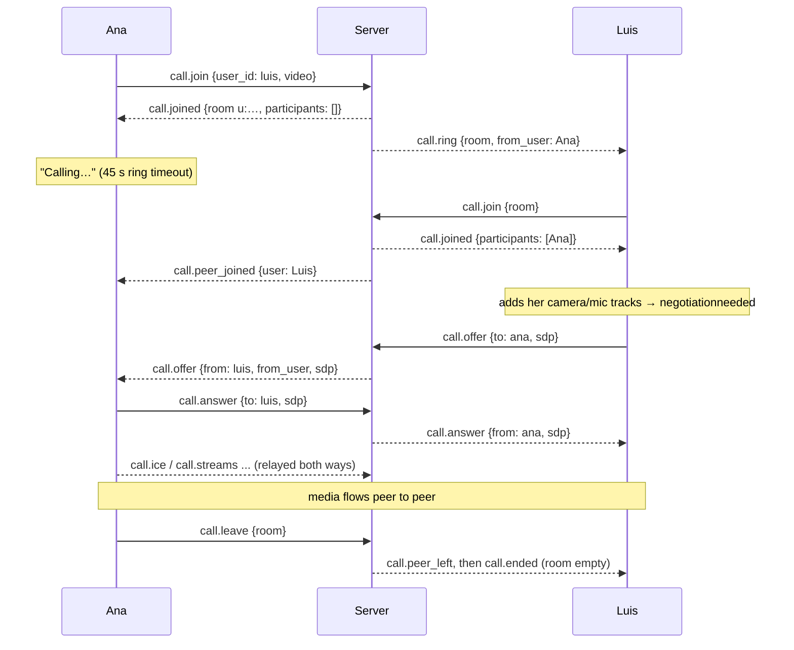

# Calls

Voice and video calls, one-to-one or in a group of up to eight, with screen
sharing. Media flows directly between participants over WebRTC in a full mesh;
the server only knows who is in which room and relays the signaling. Code:
[`server/calls.go`](../server/calls.go) and the `call*` events in
[`server/events.go`](../server/events.go); in the app
[`call.tsx`](../mobile/src/lib/call.tsx) (the manager),
[`callPeer.ts`](../mobile/src/lib/callPeer.ts) (one WebRTC connection),
[`callState.ts`](../mobile/src/lib/callState.ts) (pure state transitions),
[`callLayout.ts`](../mobile/src/lib/callLayout.ts) (what the screen shows),
[`webrtc.tsx`](../mobile/src/lib/webrtc.tsx) and its [`.web`](../mobile/src/lib/webrtc.web.tsx)
twin, and the screen [`app/call.tsx`](../mobile/src/app/call.tsx).

## Rooms

A call is a **room** keyed by a string:

- `u:<lowerId>:<higherId>` for a one-to-one call between two friends, the two ids
  in string order so both sides name the same room;
- `g:<groupId>` for a group's call, which any member may join.

The server keeps rooms in memory only (`callRooms`); they exist while someone
holds a **seat** in them. A seat belongs to the connection that took it. One
call at a time: joining a room leaves every other room first.

## The protocol

Client messages (over the WebSocket, see `clientMessage` in `events.go`):

| Message | Meaning |
| --- | --- |
| `{"type":"call.join","user_id":U,"video":bool}` | Call friend U, or pick up their call. |
| `{"type":"call.join","group_id":G,"video":bool}` | Start or join group G's call. |
| `{"type":"call.join","room":"g:<groupId>"}` | Same, by the room key a `call.ring` carried (also how a reconnecting app re-asserts its seat). |
| `{"type":"call.leave","room":key}` | Leave. |
| `{"type":"call.decline","room":key,"reason":"busy"}` | Decline a ring (`reason` optional). |
| `{"type":"call.offer"\|"call.answer"\|"call.ice"\|"call.streams","room":key,"to":U,...}` | Signaling for one participant. |

Server events: `call.ring`, `call.joined`, `call.peer_joined`, `call.peer_left`,
`call.declined`, `call.ended`, `call.unavailable`, the relayed signals, and
`error` for a refused message ([websocket.md](websocket.md#events)).

### A one-to-one call



Who hears about a room (`callAudience`): both parties of a one-to-one call, or
every member of the group, whether or not they are in it. That is how a group
chat can show *Call in progress* and how a user's other devices learn that a
ring was answered elsewhere.

### Server rules

- `callRoomFor` resolves a join: a group needs membership
  (`only members can join a group call`), a friend needs friendship
  (`you can only call friends`), you cannot call yourself, a bad room key is
  `unknown call`. Errors go back as an `error` event to that connection.
- `takeSeat` creates the room on first join (remembering whether it was placed
  as a video call), refuses a ninth participant (`the call is full`), and
  reports whether the user was already seated (a reconnecting device:
  `reassert`) and who else is there.
- A **new room** rings the audience minus the caller. A one-to-one ring that
  reaches **no connection** at all ends at once with `call.unavailable` to the
  caller. An existing room announces `call.peer_joined` instead.
- `relayCall` only forwards a signal when both the sender and the `to` user hold
  seats in that room; outsiders get `not in that call`.
- `declineCall` only tells the participants when the decliner is in the room's
  audience and not seated.
- `leaveCall` frees the seat, announces `call.peer_left`, and when the room is
  empty deletes it and announces `call.ended`.
- When a connection drops, its seats are freed after the presence grace (5 s)
  unless the same user re-asserted them from another connection (`leaveCallsOf`).
  An app that reconnects sends `call.join {room}` again and keeps its seat; a
  restarted app never does, so it does not linger as a ghost.
- Deleting a group ends its call; leaving a group leaves its call.
- `GET /api/groups/{id}` reports who is in the group's call (`call: [ids]`).

## The client

### `CallManager` (`call.tsx`)

A singleton that owns the call state and talks to the server; `useCall()` reads
its state through `useSyncExternalStore`. State changes go through the pure
helpers in `callState.ts` (`withParticipant`, `updateParticipant`, `withStream`,
`withScreen`...), so the manager only sequences them.

```
status: idle → outgoing → connecting → active      (you called)
        idle → incoming → connecting → active      (you were rung)
        idle → connecting → active                 (you joined a group call)
```

- `startCall(peer, video)` and `joinGroupCall(group, video)`: get the microphone
  (and camera for video) with `getUserMedia`, then send `call.join`. If the user
  hung up while the permission dialog was open, the stream is stopped and
  nothing is sent. An outgoing call rings for 45 s, then ends with "No answer".
- `call.ring` while idle: the state becomes `incoming` with the caller (and
  group) and `onIncoming` opens the call screen. While busy, a ring from a
  friend is declined with reason `busy` (group rings are ignored).
- `call.joined`: for every participant we have no connection with, create a
  `Peer` and add our tracks, which triggers an offer. After a reconnect it also
  reconciles: drop participants who left, keep the connections we have, offer to
  newcomers. In a one-to-one call with nobody there yet, keep ringing; alone in a
  group call, the status is `active` with "Waiting for others".
- `call.offer` from someone new creates a `Peer` without tracks, applies their
  offer, adds our tracks before answering, and answers.
- `call.peer_joined` for ourselves from another device cancels an incoming ring
  (picked up elsewhere). `call.peer_left` drops that peer; in a one-to-one call
  that ends the call. `call.declined` ends an outgoing call with "Call declined"
  or "User is on another call". `call.ended` while ringing means they hung up.
  `call.unavailable` means the friend is offline.
- Socket `close` starts a 6 s timer that ends the call with "Connection lost";
  `open` cancels it and re-sends `call.join {room}` to keep the seat.
- `end` sends `call.decline` (while incoming) or `call.leave`, then `teardown`
  stops every local track, closes every peer, and resets to idle with the
  reason as `error`, which the screen shows as a toast after it closes.

### `Peer` (`callPeer.ts`)

One `RTCPeerConnection` per other participant, using the "perfect negotiation"
pattern so both sides can add tracks at any time: the **polite** side (the one
whose id sorts higher) yields when offers collide. `onnegotiationneeded`
makes an offer; `acceptOffer` sets the remote description, optionally adds our
tracks first (so the answer carries them), flushes ICE candidates that arrived
early, and answers. Candidates that arrive before the remote description, or
before the `Peer` exists (`early` in the manager), are buffered. The ICE
configuration is `ICE_SERVERS` in `config.ts`: Google's public STUN only, so
calls across networks with strict NATs need a TURN server added there.

### Streams, camera and screen

- `call.streams {camera, screen}` tells the others which of our stream ids is
  the camera and which the screen, since WebRTC does not label them. It is sent
  when a peer connects and whenever sharing starts or stops; `withScreen`
  records it per participant.
- `toggleCamera` enables or disables the video track, or, in a voice call,
  acquires the camera now and adds the track to every peer (renegotiation).
  `flipCamera` tries `applyConstraints({facingMode})` and falls back to
  react-native-webrtc's `_switchCamera`. `toggleMute` toggles the audio track.
- `toggleScreenShare` calls `getDisplayMedia({video: true, audio: true})`
  (audio is captured where the platform allows, browsers mostly), adds the
  stream to every peer, announces it, and stops when the track ends (the
  browser's "stop sharing" button). On iOS the ReplayKit picker must be shown
  first (`ScreenCapturePickerView`, see the README's caveats); on Android the
  config plugin in `mobile/plugins/withWebRTCScreenShare.js` enables the
  media-projection foreground service.

### The screen (`app/call.tsx`)

A full-screen modal route. `callLayout(state, me)` turns the state into one of
four layouts: **portrait** (ringing, or alone: a big avatar), **one** (the other
person full screen with your own video in a corner), **stage** (a shared screen
on top with everyone in a strip; someone else's share wins over your own) or
**grid** (equal tiles, 2 columns up to four people, 3 beyond). `callSubtitle`
produces the status line. The controls are mute, camera, flip (devices only),
share screen (once active) and leave/end; while ringing, decline and accept.
`StreamView` renders a stream (`RTCView` on devices, a `<video>` on the web) and
is keyed by stream id, track count and a `version` counter so it remounts when
tracks change. On the web `RemoteAudio` plays every remote stream in an
`<audio>` element, since the video elements are muted to avoid double audio;
on devices the call audio session plays it. When the call ends the screen goes
back (or to the feed) and shows the reason as a toast.

### Where calls start

`ProfileHeader` (friends: *Call*, *Video*), `ChatView`'s header buttons, the
`CallBanner` in a group chat (*Join* / *Return*), and `GroupHeader`. Each calls
the manager and then pushes `/call`. `useChat` follows `call.ring`,
`call.peer_joined`, `call.peer_left` and `call.ended` for its group's room to
know who is in the call.
