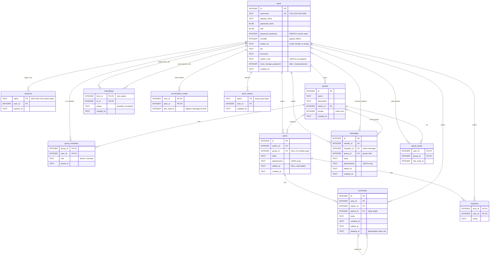

# Database schema

Ami keeps everything in one SQLite file (`-db`, default `ami.db`). Uploaded
pictures and videos are files in the media directory (`-media-dir`, default
`media`); the database only stores their URLs. The schema and the migrations are
in [`server/db.go`](../server/db.go).

## Diagram



## Conventions

- **Ids** are SQLite `INTEGER PRIMARY KEY` rowids. They increase, so "newer" means
  "higher id" and every list is paged by id (`?before=`). One consequence: SQLite
  hands out the highest id again after the highest row is deleted, which the
  read-marker code has to account for (see [messages](#messages-and-read-markers)).
- **Timestamps** are `TEXT` in RFC 3339 with nanoseconds, UTC (`2026-10-18T22:45:31.123456789Z`),
  written by `nowString()`. They compare correctly as strings, which the
  conversations sort relies on.
- **Booleans** are `INTEGER` 0 or 1 (`invisible`, `private`, `must_change_password`).
- **JSON columns** (`posts.attachments`, `messages.attachments`, `users.avatar_crop`)
  hold JSON text; defaults are `'[]'` and `''`.
- **Foreign keys** are declared with `ON DELETE CASCADE` and enforced
  (`PRAGMA foreign_keys(ON)` in the connection string), so deleting a user or a
  group removes its rows everywhere. `comments.parent_id` has no cascade: a parent
  is never hard-deleted while replies exist (see [comments.md](comments.md)).
- **Usernames** are `UNIQUE COLLATE NOCASE`: `Ana` and `ana` are the same account,
  for registration, renaming and login alike.

## Tables

### users

One row per account. `password_hash` is PBKDF2-HMAC-SHA256 of the password with
the 16-byte `salt`, using `password_iterations` rounds (600,000 today; the column
default of 210,000 is what the first release used, and a login with a lower count
re-hashes the password at the current one). Profile fields (`display_name`,
`bio`, `pronouns`, `avatar_url`, `avatar_crop`) are edited through `PUT /api/me`
([profile.md](profile.md)). `invisible` is the "appear offline" setting.
`must_change_password` is set by `-reset-password` and cleared by the next
password change ([passwords.md](passwords.md)).

### sessions

A session is a random 32-byte token the client keeps; the table stores its
SHA-256 so a leaked database yields no live sessions. `expires_at` is 30 days
after creation; expired rows are deleted hourly. One user has one row per device
signed in ([login.md](login.md#sessions)).

### groups and group_members

A group has an owner (who is also the only admin) and members with `role`
`admin` or `member`. `private` marks an invite-only group: hidden from
discovery, nobody can join on their own, only the admin adds members. Index
`group_members_user` serves "my groups" and audience queries
([groups.md](groups.md)).

### posts

A post belongs to an author and optionally to a group (`group_id` NULL means a
profile post, visible to anyone). `body` is Markdown; `attachments` is a JSON
array of `{type, url, width, height}` (see [media.md](media.md)). `edited_at` is
set by the author's edits. Indexes `posts_author` and `posts_group` serve
profile and group listings, each ordered by id ([posts.md](posts.md)).

### comments

Comments thread through `parent_id` (a reply to another comment of the same
post). Deleting a comment that has replies keeps the row with `deleted_at` set and
an empty body, so the thread below it stays readable; the API shows it as
`[deleted]`. Index `comments_post` serves listing, `comments_parent` serves the
reply counts used when deleting ([comments.md](comments.md)).

### reactions

One row per user per post, holding the emoji; changing a reaction is an upsert on
the primary key, removing it is a delete. Post queries aggregate the table into
`{emoji: count}` with `json_group_object` ([posts.md](posts.md#reactions)).

### friendships

One row per pair. `from_id` is whoever sent the request; `status` is `pending`
until the other side accepts. Removing, declining or cancelling deletes the row.
Every friendship query looks at both directions
(`(from_id = ?1 AND to_id = ?2) OR (from_id = ?2 AND to_id = ?1)`); index
`friendships_to` covers the incoming side ([friends.md](friends.md)).

### messages and read markers

A message is direct when `recipient_id` is set and a group chat message when
`group_id` is set, never both. Indexes `messages_sender` and
`messages_recipient` cover direct chats from either side, `messages_group`
covers group chats.

Unread counts come from read markers: `conversation_reads(user_id, peer_id, last_read_id)`
for direct chats and `group_reads(user_id, group_id, last_read_id)` for groups.
A message counts as unread for a user when its id is above their marker for that
chat (and, for groups, when someone else wrote it). Marking a chat read moves
the marker to the chat's highest id. Joining a group writes a marker at the
current highest id, so what was said before does not count. Because SQLite can
reuse the highest id after a delete, deleting the newest message pulls markers
sitting at or past it back to what remains, so a later message that reuses the
id still counts as unread ([messages.md](messages.md#unread-counts)).

### push_tokens

Expo push tokens, one row per device. Re-registering a token moves it to the
current user; tokens Expo reports as unregistered are deleted
([notifications.md](notifications.md)).

## How the database is opened

```go
dsn := "file:" + path + "?_pragma=journal_mode(WAL)&_pragma=foreign_keys(ON)&_pragma=busy_timeout(5000)"
db.SetMaxOpenConns(1)
```

- **WAL** lets readers proceed while a write is in flight and makes the
  `-reset-password` command safe to run beside a running server.
- **One connection** per process: SQLite allows one writer at a time, and a
  single connection turns "wait for the lock" into "wait in the pool", so no
  code path has to handle `SQLITE_BUSY`.
- **busy_timeout 5000** covers the second process case (the reset command, or a
  `sqlite3` shell) by waiting up to 5 s for a lock.

The driver is `modernc.org/sqlite`, pure Go, so the binary cross-compiles with
`CGO_ENABLED=0` ([dependencies.md](dependencies.md#go)).

## Migrations

A database records its schema version in `PRAGMA user_version`. On start,
`migrate` does one of two things:

- **A new file** (version 0 and no `users` table) gets the whole current `schema`
  plus `lateIndexes`, and its version is set to the number of migrations. New
  databases never run migrations.
- **An existing file** runs every migration past its version, in order, each in
  its own transaction that also bumps the version. A failure rolls that
  migration back and the server refuses to start with
  `migration N (<name>): <error>`.

The list today:

| Version | Name | What it does |
| --- | --- | --- |
| 1 | everything up to group chats | For databases from before versioning, which were upgraded piecemeal: creates any missing tables from `schema`, adds the columns in `addedColumns` that `CREATE TABLE IF NOT EXISTS` would not add, rebuilds `messages` so `recipient_id` can be NULL and `group_id` exists (SQLite cannot relax a constraint in place, so a copy is made), creates `lateIndexes` (on columns that only exist after this step), and writes read markers so chats older than unread tracking start out read. |
| 2 | password resets | Adds `users.must_change_password`. |

`lateIndexes` are separate from `schema` only because they index columns that an
old database gains in migration 1; a new database gets both at once.

### Adding a migration

1. Edit `schema` so a new database gets the final shape.
2. Append to `migrations` a step that brings an existing database to the same
   place: for a new column, `addColumn(tx, "table", "column", "DEFINITION")`
   (a no-op when the column exists); for anything else, SQL in the transaction.
3. If the change touches `User`, update `userCols`, `User.fields()` and the
   app's `User` type too (see [server.md](server.md#database-access)).
4. Run the tests: `migrate_test.go` upgrades a copy of the first-release schema
   through every migration, checks that a new database is already current, and
   takes a current database back one version to check the newest migration on
   its own.

The version number is the migration's position in the list, so nothing else
needs bumping.

## Working with the file

- Inspect it from the dev shell: `sqlite3 server/ami.db` (the shell has the
  `sqlite3` CLI). In WAL mode there may be `ami.db-wal` and `ami.db-shm` next to it;
  they belong to the database.
- Back it up with `sqlite3 ami.db ".backup ami-backup.db"` (safe while the server
  runs) rather than copying the file, which can miss the WAL. The media directory
  must be backed up alongside.
- Reset the development database by stopping the server and deleting
  `server/ami.db*`; `server -dev` seeds the demo content again on the next start
  (the demo pictures are rewritten into the media directory too).
