# Database schema

Ami keeps everything in a MariaDB database (`-db`, a connection string such as
`ami:password@tcp(127.0.0.1:3306)/ami`; see [server.md](server.md#flags)).
Uploaded pictures and videos are files in the media directory (`-media-dir`,
default `media`); the database only stores their URLs. The schema and the
migrations are in [`server/db.go`](../server/db.go). MariaDB rather than an
embedded database because many requests write at once (posts, messages, read
markers, presence) and InnoDB lets them, row by row, while readers carry on.

## Diagram

```mermaid
erDiagram
    users ||--o{ sessions : "signs in as"
    users ||--o{ groups : "owns"
    users ||--o{ group_members : "is a member"
    groups ||--o{ group_members : "has"
    users ||--o{ posts : "writes"
    groups |o--o{ posts : "contains"
    posts ||--o{ comments : "has"
    users ||--o{ comments : "writes"
    comments |o--o{ comments : "replies to"
    posts ||--o{ reactions : "has"
    users ||--o{ reactions : "reacts"
    comments ||--o{ comment_reactions : "has"
    users ||--o{ comment_reactions : "reacts"
    messages ||--o{ message_reactions : "has"
    users ||--o{ message_reactions : "reacts"
    users ||--o{ friendships : "asked (from_id)"
    users ||--o{ friendships : "was asked (to_id)"
    users ||--o{ messages : "sends"
    users |o--o{ messages : "receives (direct)"
    groups |o--o{ messages : "chat (group)"
    users ||--o{ conversation_reads : "read marker"
    users ||--o{ group_reads : "read marker"
    groups ||--o{ group_reads : "for"
    users ||--o{ push_tokens : "devices"
    users ||--o{ media_reactions : "reacts"
    users ||--o{ uploads : "uploaded"
    users |o--o{ invites : "spent by"

    users {
        uuid id PK "UUID, version 7"
        string username UK "unique, case-insensitive"
        string display_name
        bytes password_hash
        bytes salt
        int password_iterations "PBKDF2 rounds used"
        bool invisible "appear offline"
        string avatar_url "under /media, or empty"
        string bio
        string pronouns
        string avatar_crop "JSON {x,y,w,aspect}"
        bool must_change_password "after -reset-password"
        string cover_url "under /media, or empty"
        string cover_crop "JSON, a 3:1 window"
        string interests "JSON array of tags"
        string links "JSON array of {label, url}"
        string created_at
    }
    sessions {
        string token PK "SHA-256 of the client token"
        uuid user_id FK
        string expires_at
    }
    groups {
        uuid id PK "UUID, version 7"
        string name
        string description
        uuid owner_id FK
        bool private "invite only"
        string created_at
    }
    group_members {
        uuid group_id PK, FK
        uuid user_id PK, FK
        string role "admin | member"
        string joined_at
    }
    posts {
        uuid id PK "UUID, version 7"
        uuid author_id FK
        uuid group_id FK "NULL for profile posts"
        string body
        string attachments "JSON array"
        string edited_at "NULL until edited"
        string created_at
    }
    comments {
        uuid id PK "UUID, version 7"
        uuid post_id FK
        uuid author_id FK
        uuid parent_id FK "reply target"
        string body
        string created_at
        string edited_at
        string deleted_at "placeholder when set"
    }
    reactions {
        uuid post_id PK, FK
        uuid user_id PK, FK
        string emoji
    }
    comment_reactions {
        uuid comment_id PK, FK
        uuid user_id PK, FK
        string emoji
    }
    message_reactions {
        uuid message_id PK, FK
        uuid user_id PK, FK
        string emoji
    }
    friendships {
        uuid from_id PK, FK "who asked"
        uuid to_id PK, FK
        string status "pending | accepted"
        string created_at
    }
    messages {
        uuid id PK "UUID, version 7"
        uuid sender_id FK
        uuid recipient_id FK "direct message"
        uuid group_id FK "group chat"
        string body
        string attachments "JSON array"
        string edited_at
        string created_at
    }
    conversation_reads {
        uuid user_id PK, FK
        uuid peer_id PK, FK
        uuid last_read_id "id of the last message read"
    }
    group_reads {
        uuid user_id PK, FK
        uuid group_id PK, FK
        uuid last_read_id
    }
    push_tokens {
        string token PK "Expo push token"
        uuid user_id FK
        string updated_at
    }
    media_reactions {
        string media PK "the upload's file name"
        uuid user_id PK, FK
        string emoji
    }
    uploads {
        string name PK "the file name under the media directory"
        uuid user_id FK "who uploaded it"
        int size "bytes, for the per-account cap"
        string created_at
    }
    invites {
        string code_hash PK "SHA-256 of the one-time code"
        string created_at
        string used_at "null until spent"
        uuid used_by FK "the account it registered"
    }
```

## Conventions

- **Ids** are version 7 UUIDs stored as `CHAR(36)` in their canonical form (lowercase,
  hyphenated, 36 characters), made by `newID()` in `server/util.go` before each
  insert. The first 48 bits are the creation time, so ids sort by age as plain
  strings: "newer" means "greater", every list is paged by id (`?before=`) and
  read markers compare ids. The rest is random, so ids cannot be guessed or
  counted. Ids made by one process never go backwards; after a restart they
  continue from the clock, so only a clock set back by more than a millisecond
  could place a new row before older ones.
- **Timestamps** are `VARCHAR(35)` in RFC 3339 with nanoseconds, UTC (`2026-10-18T22:45:31.123456789Z`),
  written by `nowString()`. They compare correctly as strings, which the
  conversations sort relies on.
- **Booleans** are `TINYINT(1)` 0 or 1 (`invisible`, `private`, `must_change_password`).
- **JSON columns** (`posts.attachments`, `messages.attachments`, `users.avatar_crop`,
  `users.cover_crop`, `users.interests`, `users.links`) hold JSON text; defaults are
  `'[]'` and `''`. `interests` is searched with `JSON_SEARCH`.
- **Foreign keys** are declared with `ON DELETE CASCADE` and enforced by InnoDB,
  so deleting a user or a group removes its rows everywhere.
  `comments.parent_id` has no cascade: a parent
  is never hard-deleted while replies exist (see [comments.md](comments.md)).
- **Usernames** are unique under a case-insensitive collation: `Ana` and `ana`
  are the same account, for registration, renaming and login alike.

## Tables

### users

One row per account. `password_hash` is PBKDF2-HMAC-SHA256 of the password with
the 16-byte `salt`, using `password_iterations` rounds (600,000 today; the column
default of 210,000 is what the first release used, and a login with a lower count
re-hashes the password at the current one). Profile fields (`display_name`,
`bio`, `pronouns`, `interests`, `links`, `avatar_url`, `avatar_crop`, `cover_url`,
`cover_crop`) are edited through `PUT /api/me` ([profile.md](profile.md)). `invisible` is the "appear offline" setting.
`must_change_password` is set by `-reset-password` and cleared by the next
password change ([passwords.md](passwords.md)).

### sessions

A session is a random 32-byte token the client keeps; the table stores its
SHA-256 so a leaked database yields no live sessions. `expires_at` is 30 days
after creation; expired rows are deleted hourly through the `sessions_expires`
index. One user has one row per device signed in ([login.md](login.md#sessions)).

### groups and group_members

A group has an owner (who is also the only admin) and members with `role`
`admin` or `member`. `private` marks an invite-only group: hidden from
discovery, nobody can join on their own, only the admin adds members. Index
`group_members_user` serves "my groups" and audience queries
([groups.md](groups.md)).

### posts

A post belongs to an author and optionally to a group (`group_id` NULL means a
profile post, visible to anyone). `body` is Markdown; `attachments` is a JSON
array of `{type, url, width, height}` (see [media.md](media.md)). `edited_at` is
set by the author's edits. Indexes `posts_author` and `posts_group` serve
profile and group listings, each ordered by id ([posts.md](posts.md)).

### comments

Comments thread through `parent_id` (a reply to another comment of the same
post). Deleting a comment that has replies keeps the row with `deleted_at` set and
an empty body, so the thread below it stays readable; the API shows it as
`[deleted]`. Index `comments_post` serves listing, `comments_parent` serves the
reply counts used when deleting ([comments.md](comments.md)).

### reactions

One row per user per post, holding the emoji; changing a reaction is an upsert on
the primary key, removing it is a delete. The counts a post carries come from
one `GROUP BY` over the page's posts ([posts.md](posts.md#reactions)).

### comment_reactions

The same for comments: one row per user per comment, on the comment's id
([comments.md](comments.md#reactions)). Deleting a comment takes its reactions
with it.

### message_reactions

And for chat messages, direct or group, on the message's id
([messages.md](messages.md#reactions)); a deleted message takes its reactions
with it.

### friendships

One row per pair. `from_id` is whoever sent the request; `status` is `pending`
until the other side accepts. Removing, declining or cancelling deletes the row.
Every friendship query looks at both directions
(`(from_id = ?1 AND to_id = ?2) OR (from_id = ?2 AND to_id = ?1)`); index
`friendships_to` covers the incoming side ([friends.md](friends.md)).

### messages and read markers

A message is direct when `recipient_id` is set and a group chat message when
`group_id` is set, never both. Indexes `messages_sender` and
`messages_recipient` cover direct chats from either side, `messages_group`
covers group chats.

Unread counts come from read markers: `conversation_reads(user_id, peer_id, last_read_id)`
for direct chats and `group_reads(user_id, group_id, last_read_id)` for groups.
A message counts as unread for a user when its id is above their marker for that
chat (and, for groups, when someone else wrote it); an empty marker means
nothing was read. Marking a chat read moves the marker to the chat's highest id.
Joining a group writes a marker at the current highest id, so what was said
before does not count. Ids are never reused, so a marker left at a deleted
message stays right: anything said later has a greater id
([messages.md](messages.md#unread-counts)).

### push_tokens

Expo push tokens, one row per device. Re-registering a token moves it to the
current user; tokens Expo reports as unregistered are deleted
([notifications.md](notifications.md)).

### media_reactions

One row per user per upload, keyed by the file's name under the media
directory, since uploads are files rather than rows; a reaction stays as long
as the file does ([media.md](media.md#reactions-on-uploads)).
## How the database is opened

`openDB` parses the connection string with the driver, forces `utf8mb4` on
the wire (names and posts carry emoji), keeps timestamps as the strings the
server writes, and sets a pool of up to 32 connections (8 idle, recycled after
5 minutes). It then pings the server for up to 30 s before giving up, since
after a reboot the database may still be starting, and runs the migrations.

Tables are InnoDB with `utf8mb4` and the `utf8mb4_bin` collation, so ids,
tokens and emoji compare byte for byte, as they did in SQLite. The columns
people search carry `utf8mb4_unicode_ci` instead: `username` (which also
makes its unique key case-insensitive), `display_name`, and a group's `name`
and `description`. Timestamps are RFC 3339 strings in UTC (`VARCHAR(35)`),
which sort as time; ids are `CHAR(36)` UUIDs. Booleans are `TINYINT(1)`, JSON
(crops, interests, links, attachments) is `TEXT` the server encodes and
decodes. Foreign keys cascade on delete, so deleting an account or a group
takes everything under it along.

The driver is `github.com/go-sql-driver/mysql`, pure Go, so the binary still
cross-compiles with `CGO_ENABLED=0` ([dependencies.md](dependencies.md#go)).

## Migrations

A database records its schema version in the `schema_version` table. On
start, `migrate` does one of two things:

- **A new database** (no `users` table) gets the whole current `schema`, one
  statement at a time, and its version is set to the number of migrations.
  New databases never run migrations.
- **An existing database** runs every migration past its version, in order,
  each bumping the version when it is done. A failure stops the server with
  `migration N (<name>): <error>`. MariaDB commits DDL as it goes and cannot
  roll it back, so a migration that fails halfway leaves its earlier
  statements in place: write them so that running again is harmless
  (`addColumn` and `CREATE ... IF NOT EXISTS` are).

The list today:

| Version | Name | What it does |
| --- | --- | --- |
| 1 | index for the session purge | Adds `sessions_expires` on `sessions(expires_at)`, so the hourly purge is a range scan instead of a pass over every session. |
| 2 | reactions on comments | Runs `schema` again, whose statements are all `CREATE ... IF NOT EXISTS`, which creates `comment_reactions` and leaves the rest alone. |
| 3 | reactions on messages | The same, for `message_reactions`. |
| 4 | reactions on uploads | The same, for `media_reactions`. |
| 5 | uploads are recorded with their owner and size | The same, for `uploads`. Files from before it are recorded at the next start from whatever references them (`recordOldUploads`), so the per-account total counts them. |
| 6 | one-time invite codes | The same, for `invites`. |

(The SQLite era's migrations, up to UUID ids, went with SQLite; there is no
path from an old SQLite file to MariaDB other than starting over.)

### Adding a migration

1. Edit `schema` so a new database gets the final shape.
2. Append to `migrations` a step that brings an existing database to the same
   place: for a new column, `addColumn(tx, "table", "column", "DEFINITION")`
   (a no-op when the column exists); for anything else, SQL that is safe to
   run twice.
3. If the change touches `User`, update `userCols`, `User.fields()` and the
   app's `User` type too (see [server.md](server.md#database-access)).
4. Run the tests: `migrate_test.go` checks that a new database is current,
   that a second start changes nothing, and that `addColumn` adds a column
   once.

The version number is the migration's position in the list, so nothing else
needs bumping.

## Working with the database

- In development, `devenv up` runs MariaDB (its data under `.devenv/state/mysql`)
  with an `ami` database and an `ami` user, password `ami`, that the server
  reaches over the socket in `$AMI_DB`. `mysql -u ami -pami ami` in the shell
  opens it; `SHOW TABLES`, `DESCRIBE posts` and plain SQL work as usual.
- Back it up with `mariadb-dump --single-transaction ami > ami-$(date +%F).sql`
  (consistent while the server runs). The media directory must be backed up
  alongside.
- Reset the development database with `mysql -u ami -pami ami -e 'DROP DATABASE ami; CREATE DATABASE ami'`
  while the server is stopped; `server -dev` seeds the demo content again on the
  next start (the demo pictures are rewritten into the media directory too).
