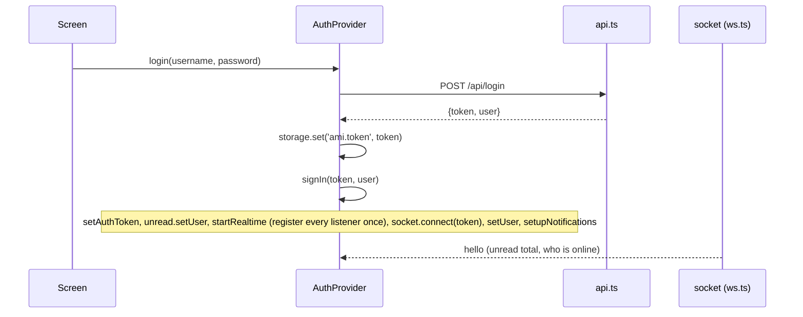

# Accounts and sessions

Registering, logging in, what a session token is and how every request is
authenticated. Code: [`server/sessions.go`](../server/sessions.go) on the server,
[`mobile/src/lib/auth.tsx`](../mobile/src/lib/auth.tsx) and the `login.tsx` /
`register.tsx` screens in the app.

## The pieces

| Piece | Where | What |
| --- | --- | --- |
| Password hashing | `sessions.go` (`hashPassword`, `storePassword`) | PBKDF2-HMAC-SHA256, 600,000 rounds (`pbkdf2Iterations`), a fresh 16-byte random salt per password, a 32-byte key. The round count is stored with the user so it can rise over time. |
| Session token | `sessions.go` (`createSession`, `tokenHash`) | 32 random bytes as 64 hex characters. The database keeps only its SHA-256, with an expiry 30 days out (`sessionTTL`). |
| `auth` wrapper | `sessions.go` (`auth`, `userForToken`, `bearerToken`) | Turns the token on a request into the account, or refuses the request. |
| Rate limit | `ratelimit.go` (`throttle`) | Register and login share a budget of 10 attempts per minute per client IP. |
| Client state | `auth.tsx` (`AuthProvider`, `useAuth`) | Keeps the signed-in `Me`, stores the token, wires the socket, notifications and the unread badge on sign-in. |

## POST /api/register

Body: `{"username": "ana", "password": "...", "display_name": "Ana García", "invite": "..."}`.

When the server runs with `-invite` (`AMI_INVITE`), `invite` must be that code
or the answer is `403 registration needs an invite code`, before anything
else is looked at. `GET /api/health` says whether it is needed
(`"registration": "invite"`), which is how the register screen decides to
show the field. Login never needs it.

Validation (`validCredentials`):

- `username`: 3 to 24 characters from `A-Z`, `a-z`, `0-9` and `_`, after trimming.
  Case does not matter for uniqueness: the column is `COLLATE NOCASE`, so a second
  `Ana` fails with `409 {"error":"username already taken"}`. Note that the reserved
  names (`deleted`, `admin`, `ami`, `me`, `system`) are only refused when
  *renaming* an account ([profile.md](profile.md#changing-the-username)), not here.
- `password`: 8 to 128 bytes.
- `display_name`: up to 50 bytes after trimming; empty means the username.

On success the account is inserted with its salt, hash and round count, a
session is created and the response is the same as login's: `200 {"token": "...", "user": Me}`.
There is no email, verification or captcha; the rate limit and, when set, the
invite code are the only brakes on mass registration.

## POST /api/login

Body: `{"username": "ana", "password": "..."}`.

`login` loads the stored hash, salt and round count by username (trimmed; the
NOCASE column makes the lookup case-insensitive), hashes the given password with
them and compares in constant time. A missing user and a wrong password both
answer `401 {"error":"invalid username or password"}`, so the API does not reveal
which usernames exist. Hashing costs real CPU (hundreds of milliseconds), which
is intended, and the 10-per-minute throttle keeps that from being a denial of
service vector on its own.

If the stored round count is below the current `pbkdf2Iterations`, the password
is re-hashed and stored with the current count right there (`storePassword`),
so raising the constant upgrades every account at its next login.

Then `issueSession` creates the session and answers `{"token", "user"}` where
`user` is the `Me` shape (the public `User` fields plus `invisible`, `bio` and
`must_change_password`).

## Sessions

- `createSession` inserts `(sha256(token), user_id, now + 30 days)` and returns the
  token to the client, which is the only place the clear token ever exists.
- `userForToken` joins `sessions` to `users` on the hash, scans the user plus
  `must_change_password` and `expires_at`, and treats a missing row or a past
  expiry as unauthorized. Expiry is checked on every request, so a stale row that
  the purge has not reached yet still cannot be used.
- `purgeSessions` deletes expired rows at start and then every hour, until the
  server's context ends.
- A password change deletes every session of the account except the one that
  made the change; a `-reset-password` deletes them all ([passwords.md](passwords.md)).
- Sessions are never refreshed: 30 days after signing in, the device signs in
  again. The app handles that by falling back to the login screen when
  `GET /api/me` fails at start.

## The `auth` wrapper

```go
func (s *server) auth(h authedHandler) http.HandlerFunc {
    return func(w http.ResponseWriter, r *http.Request) {
        su, err := s.userForToken(bearerToken(r))
        if err != nil { writeError(w, 401, "unauthorized"); return }
        noteUser(r, su.User.ID)                       // for the -verbose log
        if su.mustChangePassword && !passwordChangeOnly[r.Method+" "+r.URL.Path] {
            writeError(w, 403, "set a new password first"); return
        }
        respond(w, h(w, r, su.User))
    }
}
```

`bearerToken` reads `Authorization: Bearer <token>` and falls back to the
`?token=` query parameter, which is how the WebSocket (`GET /ws`) authenticates,
since browsers cannot set headers on a WebSocket handshake.

`passwordChangeOnly` is the whole allow-list for an account with a temporary
password: `GET /api/me`, `PUT /api/me/password`, `POST /api/logout`. Everything
else is 403 until the password is changed.

## POST /api/logout

Deletes the session row of the token that made the request and answers 204.
Other devices keep their sessions. The app calls it best-effort during logout
and clears its local state regardless of the outcome.

## GET /api/me

Answers the `Me` shape for the session's account. The app calls it at start to
resume a stored session and after a password change.

## In the app

`AuthProvider` in [`auth.tsx`](../mobile/src/lib/auth.tsx) is mounted at the root
and owns the session:



- The token is stored under `ami.token` in the Keychain / Keystore
  (`expo-secure-store`) on devices and in `localStorage` in the browser
  ([`storage.ts`](../mobile/src/lib/storage.ts) and its `.web` twin).
- At start the provider reads the token, sets it on the API client, calls
  `GET /api/me` and, if that succeeds, runs the same `signIn`. Any failure signs
  out (token removed, socket disconnected). `ready` becomes true either way, and
  the root layout shows a spinner until then.
- `startRealtime()` registers the app-wide socket listeners (unread badge,
  presence, calls) exactly once, *before* `socket.connect`, so the `hello` event
  is never missed.
- `update(patch)` changes the local `Me` for settings the user just changed
  (appear offline, the profile editor's save) without another fetch.
- `logout()` tears down notifications (forgetting this device's push token),
  calls `POST /api/logout`, then clears everything locally.

The root layout ([`app/_layout.tsx`](../mobile/src/app/_layout.tsx)) decides what
can be on screen with `Stack.Protected` groups: the tabs and every signed-in
screen need `user && !user.must_change_password`; `login` and `register` need
no user; `change-password` only needs a user and is listed last, so an account
with a temporary password lands there and nowhere else.

The login and register screens are plain forms. On the web they also ask for the
notification permission on submit, because browsers only allow that prompt in
response to a click.
