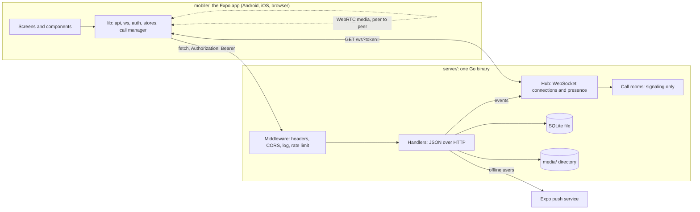
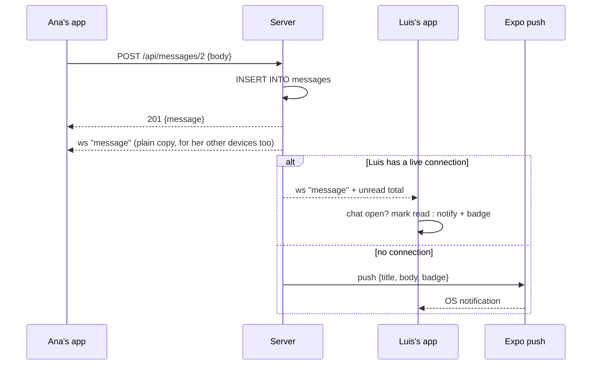

# Overview

Ami has two parts that talk over HTTP and one WebSocket:

- The **server** (`server/`) is a single binary built on the Go standard library plus
  two dependencies: a pure-Go SQLite driver and a WebSocket library. It stores
  everything in one SQLite file, keeps uploaded pictures and videos in a
  directory, serves a JSON API, pushes realtime events over a WebSocket, relays
  WebRTC signaling for calls, and sends push notifications through Expo to
  devices that are not connected.
- The **app** (`mobile/`) is an Expo Router application in TypeScript. The same
  code runs as a native development build on Android and iOS and as a web page
  (react-native-web). Platform differences live in a handful of `*.web.ts(x)`
  twins.

Call media never touches the server: participants connect to each other with
WebRTC in a full mesh, and the server only relays the offers, answers and ICE
candidates that set those connections up.

## How a request travels

1. The app calls a function on `api` in [`mobile/src/lib/api.ts`](../mobile/src/lib/api.ts), which
   does a `fetch` to `API_URL + path` with `Authorization: Bearer <token>` and a JSON body.
   `API_URL` is worked out in [`mobile/src/lib/config.ts`](../mobile/src/lib/config.ts) (see [mobile-app.md](mobile-app.md#where-the-api-is)).
2. The request enters the server's middleware chain, built in `handler()` in
   [`server/main.go`](../server/main.go): security headers, CORS, request logging,
   the per-IP API rate limit, then the router. Details in [server.md](server.md#the-middleware-chain).
3. The router (`routes()` in `main.go`) matches `METHOD /path/{id}` patterns of Go's
   `net/http` mux. Almost every route is wrapped in `auth`, which turns the token
   into a `*User` or answers 401, and refuses everything but a password change
   while an account carries a temporary password.
4. The handler reads JSON with `readJSON` (1 MB limit), validates, runs SQL,
   and returns either a value through `ok`/`created`/`noContent` or an error.
   An `*httpError` becomes its status and `{"error": "..."}`; any other error is
   logged and answered with a generic 500.
5. Right before a response is encoded, `markPresence` walks it with reflection and
   fills `online` on every `User` it finds, so no handler has to think about presence.
6. Handlers that change something other people can see push an event to the
   hub (`s.hub.sendTo`, `sendToMany`), which the app receives over the WebSocket
   and applies to whatever screen is showing the thing.

## How an event travels

The WebSocket is typed end to end: every event is a struct in
[`server/events.go`](../server/events.go) and a union member in
[`mobile/src/lib/events.ts`](../mobile/src/lib/events.ts); `socket.on('message', e => ...)`
only sees the fields that event has. [websocket.md](websocket.md) lists every event.

## The data model in one paragraph

Users have sessions (hashed tokens), friendships (one row per pair, with the
requester as `from_id`), group memberships (with a role), posts (optionally in a
group, with JSON attachments), comments (threaded by `parent_id`, soft-deleted
to placeholders when they have replies), one reaction per user per post,
messages (direct when `recipient_id` is set, group when `group_id` is set),
read markers per chat for unread counts, and push tokens. The full picture,
with a diagram, is in [database-schema.md](database-schema.md).

## Map of the server

| File | Responsibility |
| --- | --- |
| [`main.go`](../server/main.go) | Flags, startup, the middleware chain, the route table, graceful shutdown. |
| [`db.go`](../server/db.go) | The schema, migrations, and how the database is opened. |
| [`util.go`](../server/util.go) | Handler and error conventions, JSON helpers, pagination, query helpers, transactions. |
| [`sessions.go`](../server/sessions.go) | Passwords, tokens, register, login, logout, `auth`, password change and reset. |
| [`users.go`](../server/users.go) | The `User`, `Me` and `UserProfile` types, user search, profiles, a user's posts. |
| [`profile.go`](../server/profile.go) | Editing your own profile and appearing offline. |
| [`avatar.go`](../server/avatar.go) | Profile pictures and the crop shown in the circle. |
| [`posts.go`](../server/posts.go) | Posts, the feed, reactions, comments. |
| [`media.go`](../server/media.go) | Uploads, serving `/media/`, attachment validation. |
| [`friends.go`](../server/friends.go) | Friendship states and the request flow. |
| [`groups.go`](../server/groups.go) | Groups, roles and membership. |
| [`messages.go`](../server/messages.go) | Direct and group chats, read markers, unread counts, the conversations list. |
| [`push.go`](../server/push.go) | Push tokens and notifications through Expo. |
| [`events.go`](../server/events.go) | Every WebSocket event and client message, as structs. |
| [`ws.go`](../server/ws.go) | WebSocket transport settings and the upgrade. |
| [`hub.go`](../server/hub.go) | Live connections per user, fan-out, presence, the read loop. |
| [`presence.go`](../server/presence.go) | Filling `online` into responses by reflection. |
| [`calls.go`](../server/calls.go) | Call rooms and signaling relay. |
| [`ratelimit.go`](../server/ratelimit.go) | The fixed-window limiter and client IP resolution. |
| [`web.go`](../server/web.go) | Serving the browser build with a single-page fallback. |
| [`verbose.go`](../server/verbose.go) | The `-verbose` request, response and WebSocket log with redaction. |
| [`demo.go`](../server/demo.go), [`seed.go`](../server/seed.go) | Demo accounts and content for `-dev`. |
| `*_test.go` | The test suite; see [testing.md](testing.md). |

## Map of the app

| Directory | What lives there |
| --- | --- |
| [`mobile/src/app/`](../mobile/src/app) | Expo Router routes: one file per screen, layouts in `_layout.tsx`, tabs in `(tabs)/`. Route files are thin; the bodies are components. |
| [`mobile/src/components/`](../mobile/src/components) | Screen bodies (`ChatView`, `GroupView`, `PostView`, `UserView`, `ProfileEditor`, `PasswordForm`), cards and rows, the composer, the media viewer, the UI kit in `ui.tsx`. |
| [`mobile/src/lib/`](../mobile/src/lib) | Everything that is not a view: the API client, the socket, auth, stores, hooks, the call manager, notifications, theme, helpers. |
| [`mobile/src/theme.ts`](../mobile/src/theme.ts) | Colours, spacing, radii, the reaction emoji list. |
| [`mobile/e2e/`](../mobile/e2e) | Python scripts that drive the Android build on emulators. |
| [`mobile/plugins/`](../mobile/plugins) | Expo config plugins that patch the generated native projects. |

[mobile-app.md](mobile-app.md) walks through all of it.

## Conventions worth knowing before reading code

- **Handlers return errors.** No handler writes an error itself; it returns one and `respond` does the rest. See [server.md](server.md#handler-conventions).
- **Scanning by column list.** A type that comes out of SQL has a `fields()` method listing scan targets in the same order as its column constant (`userCols`, `messageCols`); rows that span types are scanned by concatenating the lists with `fields(a, b)`.
- **Timestamps are text.** Every `*_at` column is an RFC 3339 string with nanoseconds, in UTC, produced by `nowString()`. They sort correctly as strings.
- **JSON columns.** `attachments` and `avatar_crop` are JSON text; the Go types marshal in and out.
- **Audiences.** Who gets an event is computed by small functions (`postAudience`, `chatAudience`, `callAudience`) so the rule lives in one place.
- **The app applies the server's reply at once** and treats the WebSocket echo of the same change as a no-op, so your own edits never depend on the socket being up. After a reconnect, screens fetch the latest page again.
- **Platform twins.** `storage.ts`/`storage.web.ts`, `webrtc.tsx`/`webrtc.web.tsx` and friends export the same names; Metro picks the `.web` file for the browser.
- **Wide windows.** Above 900 px the tabs become a sidebar and each tab shows its list beside the open item, with the selection in the URL. The same route files serve phones.
